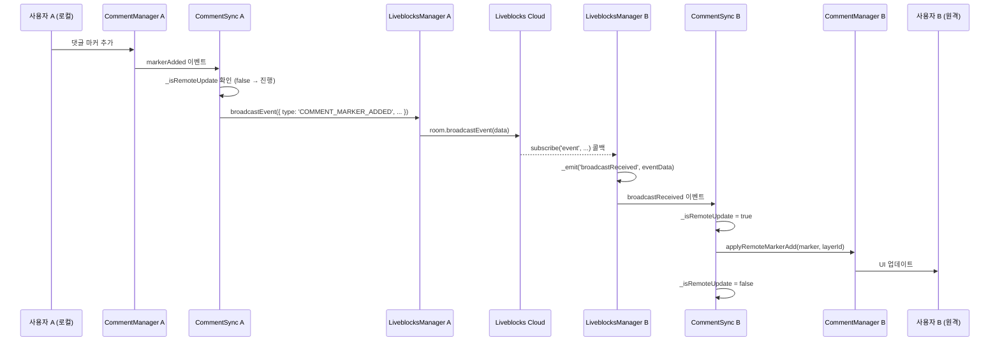
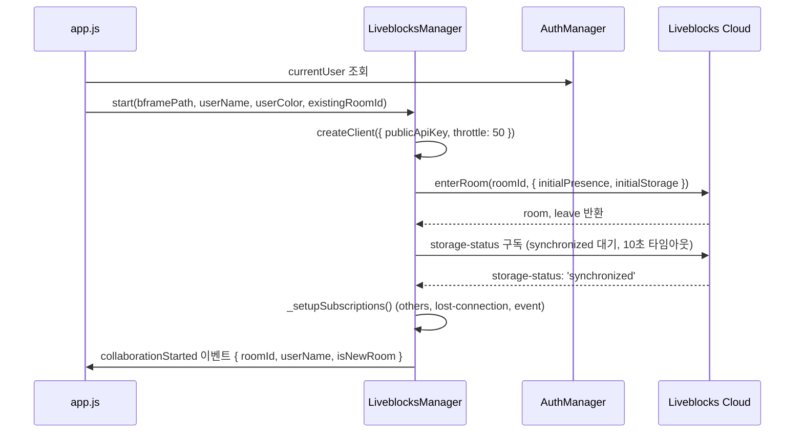
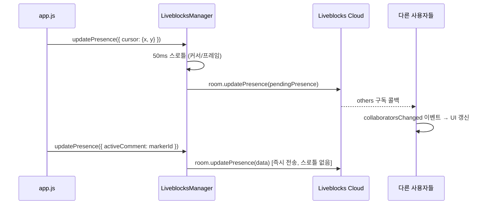

# 실시간 협업 시스템

> Liveblocks 기반 실시간 협업 기능의 아키텍처와 구현을 설명합니다.

---

## 1. 개요

### 목적

여러 사용자가 동일한 `.bframe` 파일을 동시에 열어 댓글 작성, 그리기, 커서 공유를 실시간으로 경험할 수 있도록 합니다.

### 기술 선택: Liveblocks

기존 협업 시스템은 Google Drive 파일 동기화(`.collab` 파일)에 의존했으며 다음 한계가 있었습니다:

| 한계 | 기존 방식 | Liveblocks |
|------|----------|------------|
| 동기화 지연 | 3~30초 | ~50ms (Broadcast) |
| Presence 업데이트 | 10초 폴링 | 즉시 (WebSocket) |
| 오프라인 감지 | 45초 타임아웃 | ~2초 |
| 충돌 해결 | 타임스탬프 비교 (last-write-wins) | Broadcast 기반 이벤트 전달 |
| 인프라 | Google Drive Desktop 필수 | 인터넷 + API 키 |

LAN P2P(WebRTC) 방식도 검토했으나, 네트워크 환경 의존성(NAT, STUN/TURN 서버)과 재택 근무 지원 불가 문제로 Liveblocks SaaS 방식을 채택했습니다.

**의존성**: `@liveblocks/client ^2.0.0`

**번들링**: Electron 렌더러에서 ESM으로 사용하기 위해 esbuild로 사전 번들링합니다.

```bash
npm run bundle:liveblocks
# esbuild ./node_modules/@liveblocks/client/dist/index.js --bundle --format=esm
# --outfile=renderer/scripts/lib/liveblocks-client.js
```

`postinstall` 훅에 등록되어 `npm install` 시 자동으로 실행됩니다.

---

## 2. 아키텍처

### Liveblocks Room 구조

각 `.bframe` 파일 하나가 하나의 Liveblocks Room에 대응됩니다.

- **첫 접속자**: Room ID를 생성하여 `.bframe` 파일의 `liveblocksRoomId` 필드에 저장
- **이후 접속자**: `.bframe`에서 `liveblocksRoomId`를 읽어 동일 Room에 접속
- Google Drive로 `.bframe` 파일이 공유되므로 Room ID도 자동으로 팀원과 공유됨

Room ID 형식: `bframe_{timestamp36}_{random12}`

### Broadcast 기반 통신

초기 설계에서는 Liveblocks Storage(CRDT)로 댓글을 동기화하려 했으나, Storage 구독 콜백이 실제로 작동하지 않는 문제가 발생했습니다. 이미 정상 작동하던 Broadcast 채널을 사용하도록 전환했습니다.

**현재 통신 전략:**

| 데이터 | 전송 방식 | 이유 |
|--------|---------|------|
| 댓글 CRUD (마커, 답글, 레이어) | Broadcast | Storage 구독 불안정 문제로 전환 |
| 그리기 (스트로크, 키프레임) | Broadcast | Base64 이미지 데이터 크기 (100KB~수MB) → CRDT 부적합 |
| 커서 위치, 재생헤드 프레임 | Presence | 실시간 상태 공유 |
| 편집 잠금 | Presence (`activeComment` 필드) | 즉시 반영 필요 |

**Broadcast의 한계와 폴백:**
- Broadcast는 현재 접속 중인 사용자에게만 전달됨
- 늦게 접속한 사용자는 로컬 `.bframe` 파일에서 데이터를 로드
- Google Drive 파일 감시(file:watch)를 폴백 안전망으로 유지 (~10초 지연)
- 한 Room 에 동시에 들어올 수 있는 사람은 요금제가 정한다(현재 10명). 넘는 사람은 파일 동기화로 일한다 — [8. Room 정원과 파일 동기화](#8-room-정원과-파일-동기화)

### 동기화 범위

- **댓글**: 마커 추가/수정/삭제, 답글 추가/수정/삭제, 레이어 추가/제거
- **그리기**: 스트로크 시작/중간/종료 스트리밍, 키프레임 완성 데이터, 레이어 생성/삭제
- **Presence**: 마우스 커서 위치(정규화 좌표), 현재 재생 프레임, 그리기 모드 여부, 편집 중인 댓글 ID

---

## 3. 모듈 구조

### 3.1 liveblocks-manager.js

`renderer/scripts/modules/liveblocks-manager.js`

Room 생성, 연결, 해제 및 모든 Liveblocks 통신의 중앙 관리 모듈입니다. `EventTarget`을 상속하여 `app.js`의 기존 협업 인터페이스와 호환됩니다.

**주요 기능:**

- `start(bframePath, userName, userColor, existingRoomId)`: Room 접속. 연결과 Storage 로드가 끝날 때까지 기다린다(`_waitForRoomJoin`, 10초). 접속이 거절되거나 시간이 넘으면 `joinFailureReason`(`room-full`·`timeout`·`connection-error`)을 실은 오류로 끝난다
- `stop()`: Room 퇴장 및 모든 구독 해제
- `updatePresence(data)`: Presence 업데이트. `activeComment`, `userName`, `userColor`는 즉시 전송, 커서/프레임은 50ms 스로틀
- `broadcastEvent(data)`: Broadcast 메시지 전송
- `getOthers()`: 현재 접속 중인 다른 사용자 목록
- `checkEditLock(markerId)`: Presence 기반 편집 잠금 확인

**발행 이벤트:**

| 이벤트 | 설명 |
|--------|------|
| `collaborationStarted` | Room 접속 성공 |
| `collaboratorsChanged` | 접속자 목록 변경 |
| `broadcastReceived` | Broadcast 메시지 수신 |
| `connectionStatusChanged` | 연결 상태 변경 (`connected` / `reconnecting` / `disconnected`) |

**Presence 초기값:**

```javascript
{
  cursor: null,         // { x, y } 정규화 좌표
  currentFrame: 0,
  isDrawing: false,
  activeComment: null,  // 편집 중인 마커 ID (잠금 역할)
  userName: '...',
  userColor: '...'
}
```

**Storage 초기값 (현재 미사용, 구조 보존):**

```javascript
{
  commentLayers: new LiveList([]),
  highlights: new LiveList([]),
  drawingMeta: new LiveList([])
}
```

### 3.2 comment-sync.js

`renderer/scripts/modules/comment-sync.js`

CommentManager와 Liveblocks Broadcast 간 양방향 동기화를 담당합니다.

**Local → Remote**: CommentManager가 발행하는 이벤트를 수신하여 Broadcast로 전송

| CommentManager 이벤트 | Broadcast 타입 |
|----------------------|---------------|
| `markerAdded` | `COMMENT_MARKER_ADDED` |
| `markerUpdated` | `COMMENT_MARKER_UPDATED` |
| `markerDeleted` | `COMMENT_MARKER_DELETED` |
| `replyAdded` | `COMMENT_REPLY_ADDED` |
| `replyUpdated` | `COMMENT_REPLY_UPDATED` |
| `replyDeleted` | `COMMENT_REPLY_DELETED` |
| `layerAdded` | `COMMENT_LAYER_ADDED` |
| `layerRemoved` | `COMMENT_LAYER_REMOVED` |

**Remote → Local**: `broadcastReceived` 이벤트를 수신하여 `COMMENT_*` 타입별로 분기, CommentManager의 `applyRemote*` 메서드 호출

**무한 루프 방지**: `_isRemoteUpdate` 플래그로 원격에서 온 변경이 다시 Broadcast로 나가지 않도록 차단

### 3.3 drawing-sync.js

`renderer/scripts/modules/drawing-sync.js`

DrawingManager와 Liveblocks Broadcast 간 양방향 동기화를 담당합니다.

**Broadcast 메시지 크기 제한**: 1MB (`MAX_BROADCAST_SIZE = 1024 * 1024`)

**Local → Remote 흐름:**

| DrawingManager 이벤트 | Broadcast 타입 | 설명 |
|----------------------|---------------|------|
| `drawstart` (캔버스) | `STROKE_START` | 스트로크 시작 스트리밍 |
| `drawmove` (캔버스) | `STROKE_MOVE` | 스트로크 진행 스트리밍 |
| `drawend` | `DRAWING_KEYFRAME_UPDATE` | 완성된 키프레임 (Base64) |
| `layerCreated` | `DRAWING_LAYER_CREATED` | 레이어 생성 |
| `layerDeleted` | `DRAWING_LAYER_DELETED` | 레이어 삭제 |
| `keyframeRemoved` | `DRAWING_KEYFRAME_REMOVED` | 키프레임 삭제 |

스트로크 데이터는 `_strokeBuffer`에 누적 후 타이머로 flush하여 네트워크 부하를 줄입니다.

### 3.4 auth-manager.js

`renderer/scripts/modules/auth-manager.js`

사용자 인증 및 세션 관리를 담당합니다. 인증 파일 기반으로 팀원을 관리합니다.

**인증 방식:**
- 관리자 계정(하드코딩)으로 사용자 등록/삭제 관리
- 팀원은 이름을 입력하여 로그인 (비밀번호 불필요)
- 사용자별 테마 색상 선택 가능 (`기본(노랑)`, `빨강`, `파랑`, `핑크`, `초록`)

**주요 메서드:**
- `init()`: 앱 시작 시 인증 파일 로드
- `registerUser(name, theme)`: 신규 팀원 등록
- `isAuthAvailable()`: 인증 파일 접근 가능 여부 확인

로그인된 사용자의 이름과 색상이 Liveblocks Presence에 전달됩니다.

---

## 4. 데이터 흐름

### 댓글 작성 시퀀스 (Broadcast 방식)



### Room 접속 흐름



### Presence 업데이트 흐름



---

## 5. 설정

### Liveblocks Public Key

`renderer/scripts/modules/liveblocks-manager.js`에 하드코딩된 클라이언트용 공개 키를 사용합니다. 공개 키는 코드에 포함해도 안전합니다.

```javascript
const LIVEBLOCKS_PUBLIC_KEY = 'pk_dev_lKwyJLI2vKSI63mnDwK1zh6yKWzLflm_...';
```

### 클라이언트 설정

```javascript
createClient({
  publicApiKey: LIVEBLOCKS_PUBLIC_KEY,
  throttle: 50  // Presence 업데이트 최소 간격 (ms)
});
```

### 번들링

Electron 렌더러 프로세스는 Node.js 모듈을 직접 사용할 수 없으므로 `@liveblocks/client`를 ESM 형식으로 번들링합니다.

```bash
# npm install 시 자동 실행 (postinstall 훅)
npm run bundle:liveblocks
```

출력 파일: `renderer/scripts/lib/liveblocks-client.js`

`LiveObject`, `LiveList`, `LiveMap`은 `globalThis`에 등록하여 CommentSync, DrawingSync에서 접근 가능합니다.

---

## 6. 개발 히스토리

### 1단계: 설계 (2026-02-28)

기존 Google Drive 파일 동기화(`.collab` 파일, `CollaborationManager` 828줄)의 한계를 분석하고 Liveblocks 전환을 계획했습니다. LAN P2P(WebRTC) 방식을 검토했으나 네트워크 의존성 문제로 Liveblocks SaaS로 결정했습니다.

초기 설계는 다음 구조를 목표로 했습니다:
- **Presence**: 커서, 프레임 위치, 편집 상태 실시간 공유
- **Storage (CRDT)**: 댓글, 하이라이트 충돌 없는 동기화 (LiveList, LiveObject)
- **Broadcast**: 그리기 데이터 (Base64 이미지 크기 문제로 CRDT 대신)

총 7개 Phase로 구성: 인프라, Presence, 댓글 CRDT, 그리기 브로드캐스트, 로컬 저장 통합, 기존 시스템 정리, 스키마 업데이트 (Phase 8 웹 뷰어는 향후 과제)

### 2단계: Storage → Broadcast 전환 (2026-03-01)

Liveblocks Storage(CRDT) 구독 콜백이 한 번도 실행되지 않는 문제가 발견됐습니다. Presence와 동일한 WebSocket 경로를 사용하는 Broadcast는 정상 작동했으므로, 댓글 동기화도 Broadcast 방식으로 전환했습니다.

**변경 내용:**
- `comment-sync.js`: Storage 구독 코드 전체 제거, Broadcast 기반으로 재작성
- `drawing-sync.js`: Storage 메타 업로드 코드 제거, Broadcast 코드 유지
- `app.js`: `commentSync.start()` 인자 제거, 파일 감시 항상 활성화
- `liveblocks-manager.js`: Broadcast 송수신 진단 로그 추가

**.bframe 파일 저장**은 기존 auto-save(500ms debounce)가 그대로 담당하며, Google Drive 파일 감시는 Broadcast를 놓쳤을 때의 폴백으로 유지됩니다.

### 현재 상태

| Phase | 항목 | 상태 |
|-------|------|------|
| Phase 1 | 인프라 & SDK 설치, LiveblocksManager | 완료 |
| Phase 2 | Presence & 커서 공유 | 완료 |
| Phase 3 | 댓글 동기화 (Broadcast 전환) | 완료 |
| Phase 4 | 그리기 브로드캐스트 | 완료 |
| Phase 5 | 로컬 저장 통합 | 완료 |
| Phase 6 | 기존 시스템 정리 | 완료 |
| Phase 7 | 스키마 업데이트 (liveblocksRoomId) | 완료 |
| Phase 8 | 웹 뷰어 통합 | 대기 (향후) |

---

## 7. 표시 계층 현황 (2026-08 기준)

Liveblocks가 실어 나르는 presence/broadcast 데이터를 화면에 그리는 계층은 다음과 같습니다. mpv 재생 중에는 mpv가 네이티브 자식 창으로 렌더링하므로, DOM 표시 요소를 오버레이 창으로 **미러링**해야 보입니다.

### 7.1 렌더러 DOM 표시 요소

| 표시 요소 | 파일 · 앵커 |
|-----------|-------------|
| 협업 아바타 지표(호버 패널) | `renderer/scripts/app.js` — `handleCollaborationIndicatorEnter()`, `handleCollaborationIndicatorLeave()` |
| 접속 리플 애니메이션 | `renderer/scripts/app.js` — `_triggerCollabRipple()`, 내부 `animateRipple()` |
| 플렉서스 패널 | `renderer/scripts/modules/plexus.js` — `PlexusEffect`. 마운트 지점은 `app.js`의 `elements.collabPlexusPanel` / `elements.collabPlexusCanvas`, 설정 토글은 `togglePlexusPanel`(`userSettings.settings.showPlexusPanel`), 해제는 `_hideCollabPlexusPanel()` |
| 원격 커서 | `renderer/scripts/app.js` — `renderRemoteCursors()`, `createRemoteCursorElement()`, `clearRemoteCursors()`. 표시 토글 버튼은 `updateRemoteCursorToggleButton()` |
| 타임라인 원격 재생헤드 | `renderer/scripts/app.js` — `renderRemotePlayheads()` |

### 7.2 mpv 협업 미러 (COLLABORATION_MIRROR)

mpv 재생 중 위 표시 요소를 오버레이 창에 복제하는 경로입니다.

| 항목 | 파일 · 앵커 |
|------|-------------|
| 서피스 모드 상수 | `renderer/scripts/modules/mpv-surface-policy.js` — `MPV_SURFACE_MODE.COLLABORATION_MIRROR` |
| 미러 영역 히트테스트 | `renderer/scripts/app.js` — `findClosestMpvSurface(event.target, MPV_SURFACE_MODE.COLLABORATION_MIRROR)`, `MPV_COLLABORATION_MIRROR_OVERLAY_SELECTOR` |
| 원격 커서 HTML 직렬화/동기화 | `renderer/scripts/app.js` — `serializeMpvOverlayRemoteCursorHtml()`, `syncMpvOverlayRemoteCursorState()`, `scheduleMpvOverlayRemoteCursorStateSync()` |
| 플렉서스 캔버스 스냅샷 전송 | `renderer/scripts/app.js` — `captureMpvCollaborationPlexusSnapshot()` |
| 오버레이 액션 릴레이 | `renderer/scripts/modules/mpv-overlay-collaboration-action-relay.js`, 채널 상수 `MPV_OVERLAY_COLLABORATION_ACTION_CHANNEL`(`main/mpv-overlay-host.js`) |
| 재시도 정책 | `renderer/scripts/modules/mpv-collaboration-retry.js` |
| 미러 페이로드 한도(main) | `main/mpv-overlay-host.js` — `MAX_MPV_REMOTE_CURSOR_HTML_BYTES`, `MAX_MPV_COLLABORATION_STATE_BYTES`, `MAX_MPV_COLLABORATION_SNAPSHOT_BYTES`, `MAX_MPV_COLLABORATION_USERS`, `MAX_MPV_COLLABORATION_NAME_LENGTH`, `MAX_MPV_COLLABORATION_BOUND` |

### 7.3 접속·재연결 시 참여자 스냅샷 보장

| 보장 | 구현 위치 |
|------|-----------|
| **구독 설치가 Storage 로드보다 앞선다** — `room.subscribe('others')`는 초기 발화가 없는 순수 이벤트 소스라, Storage 동기화 `await` 뒤에 구독하면 접속 직후의 초기 참여자 상태(ROOM_STATE)를 영구히 놓친다 | `renderer/scripts/modules/liveblocks-manager.js` — `start()` 안 `this._setupSubscriptions()` 호출이 `// Storage 로드 대기` 블록 **위**에 위치 |
| **`collaboratorsChanged`는 접속 직후와 재연결 복구 시 보상 발행된다** — 구독 이전에 확정된 목록, `lost` 로 비워진 뒤의 복구 목록을 각각 1회 재푸시한다 | 같은 파일 — `_emitCollaboratorsChanged()`(유일한 발행 지점), `start()` 의 `return` 직전 1회, `lost-connection` 의 `else if (event === 'restored')` 분기 1회 |

기존 참여자가 마우스를 움직여야 목록에 나타나던 증상, `lost` → `restored` 후 목록이 1명으로 고착되던 증상이 이 두 보장으로 닫힙니다.

### 7.4 관련 테스트

`npm run test:mpv`에 포함된 `scripts/tests/mpv-collaboration-mirror.test.js`, `scripts/tests/mpv-overlay-collaboration-action-relay.test.js`, `scripts/tests/mpv-collaboration-retry.test.js`, `scripts/tests/mpv-liveblocks-visibility.test.js`, `scripts/tests/mpv-surface-policy.test.js`와 `npm run test:collaboration`의 `scripts/tests/collaboration-cursors-source.test.js`가 이 계층을 덮습니다. 그리고 `collaboration-cursors-source.test.js` 의 신규 3건이 7.3의 두 보장을 소스 단언으로 강제합니다.

---

## 8. Room 정원과 파일 동기화

(2026-11-18, v2.16.3-beta. 조사 기록: `DEVLOG/2026-11-18-comment-resolve-realtime.md`)

### 8.1 정원

Liveblocks 는 한 Room 의 동시 접속 수를 요금제로 제한한다(Free·Pro 10, Team 50, Enterprise 100). 넘는 접속은 `code 4005` 로 거절되고, 클라이언트는 예외를 던지지 않고 재시도도 하지 않는다. `room.subscribe('error')` 로만 알 수 있다.

| 상황 | 동작 | 구현 위치 |
|------|------|-----------|
| 정원 초과·접속 불가 | 접속 대기를 끝내고 사유를 알린다. 파일 감시는 접속 성패와 무관하게 시작한다 | `liveblocks-manager.js` — `_waitForRoomJoin()`, `app.js` — `startCollaborationForVideoLoad()` 의 `catch` |
| 접속하지 못한 채 작업 | 파일 동기화(`syncReviewFileFromDisk` → `reloadAndMerge`). 다른 사람의 변경은 드라이브가 파일을 옮기는 시간만큼 늦다 | `app.js` |
| 접속을 기다리는 중에 영상 전환 등으로 방을 떠남 | 그 접속 시도를 바로 끝낸다(`joinFailureReason: 'superseded'`, 실패로 알리지 않는다). 버려진 시도는 공유 상태를 건드리지 않고 자기 방만 떠난다 — 제한 시간 뒤의 실패 처리가 그 사이 들어간 새 방을 끊지 않게 | `liveblocks-manager.js` — `start()` 의 `catch`, `stop()` 의 `_abortPendingJoin` |
| 빈자리 | 1·3·5·10·10·10분 뒤 다시 접속해 본다. 그 뒤에는 동기화 상태 표시(`#syncStatus`)를 누르면 다시 시도한다. 거절된 접속도 사용량으로 잡힐 수 있어 자주 시도하지 않는다 | `app.js` — `scheduleCollaborationRejoin()`, `retryCollaborationJoin()` |

### 8.2 연결 중에도 댓글을 파일에서 받아들인다

정원 밖 사용자는 Broadcast 를 보낼 수 없어 그 사람의 댓글·해결은 파일로만 도착한다. 연결 중인 사용자는 파일이 바뀔 때마다(0.5초 스로틀) 드로잉(`reloadDrawingsV3FromDisk`)·이어받기(`reloadReviewCarryoverFromDisk`)와 함께 댓글도 받아들인다(`ReviewDataManager.reloadCommentsFromDisk`). 댓글만 다루고 dirty·자동 저장·CAS 관측값은 건드리지 않는다. 내용이 같으면(수정 시각만 다르면) 화면을 다시 그리지 않는다.

### 8.3 옛 사본을 받아들이지 않는 규칙

같은 파일을 여러 PC 가 각자 저장하고 드라이브는 마지막 업로드를 남기므로, 디스크의 파일이 화면보다 **옛 사본**인 일이 흔하다. 댓글 병합(`mergeCommentDataThreeWay`)은 양쪽이 다를 때마다 아래 순서로 판정한다. 저장 직전 병합·파일 재로드·연결 중 받아들이기가 같은 규칙을 쓴다.

| 규칙 | 구현 |
|------|------|
| 원격 댓글이 이 인스턴스가 들고 있던 상태와 똑같으면(수정 시각 포함) 옛 사본 후보다. **화면으로 받아들일 때**는 그것만으로 옛 사본이다 — 화면은 이미 지나온 상태로 되돌아가지 않는다(PC 사이의 시계 차이와 무관). **파일에 쓸 때와 파일을 바로잡을 때**는 그 상태가 지금 로컬보다 앞선 상태일 때만 옛 사본이다. 앞뒤는 수정 시각, 같으면 내용 순서로 정한다(`compareMarkerRevisions`) — 어느 PC 에서나 같은 답이어야 두 PC 가 서로의 저장분을 옛 사본으로 보고 덮어쓰기를 되풀이하지 않는다 | `_createCommentMergeOptions().isSupersededMarker`, 상태 기록은 `_rememberMarkerRevision`(로드·변경 이벤트·저장·재로드 때. 모델이 내보내는 모양만 기억하고 파일에 적힌 모양은 기억하지 않는다) |
| 파일에 댓글이 없으면 삭제가 아니라 그 댓글이 생기기 전의 사본이다(삭제는 `deleted` 표시로 남는다) | 마커 컬렉션의 `absentMeansStale` |
| 본문·위치는 같고 해결 상태만 서로 다르게 바뀌었으면 나중 변경을 따른다. 충돌 사본을 만들지 않는다 | `selectMarkerMetadata` |
| 삭제 표시끼리는 삭제 시각을 본문 차이로 보지 않는다(삭제를 전송으로 받으면 받은 쪽 시계로 삭제 시각이 찍힌다). 차이로 보면 삭제 표시 사본이 생기고, 삭제 되돌리기가 충돌 사본으로 생긴다 | `getMarkerContentForMerge` |
| 본문 수정과 다른 변경이 겹치면 지금처럼 로컬 + `__remote-conflict` 사본으로 보존한다 | `selectMarkerMetadata` |
| 답글은 이미지 칸의 유무(없음·null)를 맞춰 비교한다 | `normalizeReplyForMerge` |
| 원격이 가진 답글이 로컬 목록의 앞부분뿐이고 "답글만 지운" 편집이 아니면, 빠진 답글은 원격이 아직 못 본 것이다. 지우지 않는다. 단 원격에 새 답글을 쓴 사람의 옛 답글이 빠졌으면 그 사람이 지우고 다시 쓴 것이므로 지운다 | `createUnseenReplyKeeper` |
| 이 인스턴스에 있다가 사라진 답글이 원격에만 있으면 되살리지 않는다 | `hasSeenReply` |
| 파일이 옛 사본으로 돌아가 있으면(파일에 없는 댓글이 있거나 파일의 댓글이 지나온 상태) 받아들이는 쪽이 다시 저장해 파일을 바로잡는다. 파일로만 동기화하는 사람은 그 파일만 본다 | `hasCommentStateAheadOfRemote` → `_markDirty` |
| 받아들인 뒤의 병합 기준은 방금 읽은 원격으로 옮긴다. 옛 사본이라 받아들이지 않은 댓글만 예전 기준을 둔다 | `advanceCommentMergeBase` |

**예전 상태를 그대로 되살리는 편집은 새 수정으로 찍는다.** 위 첫 규칙은 "지나온 상태와 똑같은 원격은 옛 사본" 이라고 보므로, 삭제 되돌리기(Ctrl+Z)·생성 다시하기처럼 예전 스냅샷을 그대로 되살리는 편집이 예전 수정 시각을 달고 있으면 다른 PC 가 받아들이지 않는다. `CommentManager.restoreMarker()` 와 `restoreMarkerResolution()` 은 되살리면서 수정 시각을 새로 찍는다. 댓글을 예전 값으로 돌려놓는 경로를 새로 만들 때도 같다.

해결·수정 전송(`COMMENT_MARKER_UPDATED`)은 전송 시각이 아니라 모델의 수정 시각을 싣는다. 보낸 쪽과 받은 쪽이 같은 상태 지문을 가져야 위 첫 규칙이 서로의 저장분에도 맞는다.

### 8.4 해결 클릭

현재 영상의 댓글 목록에서 누른 해결은 누른 순간 화면에 반영하고 전송한다. 저장은 같은 파일의 다른 저장 뒤에 차례로 하며, 버전 충돌·지연으로 미뤄지면 되돌리지 않고 다시 저장한다(`saveResolutionThroughCheckpoint`, 그래도 안 되면 자동 저장 재시도). 재생목록 모음 목록의 해결은 실패 시 되돌리고 "저장 실패 · 다시 시도" 를 보이는 기존 방식이다.

### 8.5 관련 테스트

`npm run test:collaboration` 의 `scripts/tests/comment-collaboration-convergence.test.js`(정원 초과 접속, 파일로 온 해결, 옛 사본, 충돌 사본, 저장 충돌 재시도), `npm run test:playlist` 의 `scripts/tests/playlist-comment-resolution.test.js`(해결 클릭의 즉시 반영·되돌리지 않음·재접속 연결).

