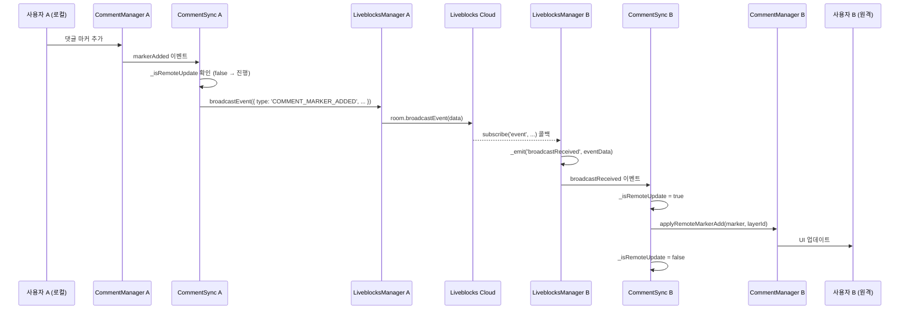
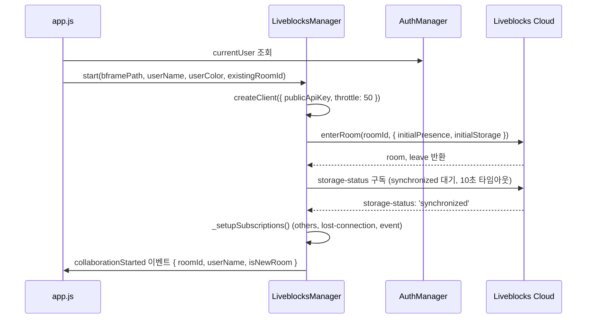
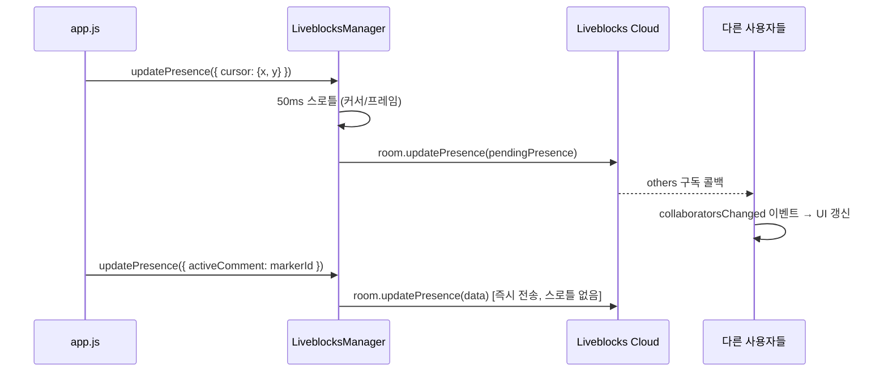

# 실시간 협업 시스템

> Liveblocks 기반 실시간 협업 기능의 아키텍처와 구현을 설명합니다.

---

## 1. 개요

### 목적

여러 사용자가 동일한 `.bframe` 파일을 동시에 열어 댓글 작성, 그리기, 커서 공유를 실시간으로 경험할 수 있도록 합니다.

### 기술 선택: Liveblocks

기존 협업 시스템은 Google Drive 파일 동기화(`.collab` 파일)에 의존했으며 다음 한계가 있었습니다:

| 한계 | 기존 방식 | Liveblocks |
|------|----------|------------|
| 동기화 지연 | 3~30초 | ~50ms (Broadcast) |
| Presence 업데이트 | 10초 폴링 | 즉시 (WebSocket) |
| 오프라인 감지 | 45초 타임아웃 | ~2초 |
| 충돌 해결 | 타임스탬프 비교 (last-write-wins) | Broadcast 기반 이벤트 전달 |
| 인프라 | Google Drive Desktop 필수 | 인터넷 + API 키 |

LAN P2P(WebRTC) 방식도 검토했으나, 네트워크 환경 의존성(NAT, STUN/TURN 서버)과 재택 근무 지원 불가 문제로 Liveblocks SaaS 방식을 채택했습니다.

**의존성**: `@liveblocks/client ^2.0.0`

**번들링**: Electron 렌더러에서 ESM으로 사용하기 위해 esbuild로 사전 번들링합니다.

```bash
npm run bundle:liveblocks
# esbuild ./node_modules/@liveblocks/client/dist/index.js --bundle --format=esm
# --outfile=renderer/scripts/lib/liveblocks-client.js
```

`postinstall` 훅에 등록되어 `npm install` 시 자동으로 실행됩니다.

---

## 2. 아키텍처

### Liveblocks Room 구조

각 `.bframe` 파일 하나가 하나의 Liveblocks Room에 대응됩니다.

- **첫 접속자**: Room ID를 생성하여 `.bframe` 파일의 `liveblocksRoomId` 필드에 저장
- **이후 접속자**: `.bframe`에서 `liveblocksRoomId`를 읽어 동일 Room에 접속
- Google Drive로 `.bframe` 파일이 공유되므로 Room ID도 자동으로 팀원과 공유됨

Room ID 형식: `bframe_{timestamp36}_{random12}`

### Broadcast 기반 통신

초기 설계에서는 Liveblocks Storage(CRDT)로 댓글을 동기화하려 했으나, Storage 구독 콜백이 실제로 작동하지 않는 문제가 발생했습니다. 이미 정상 작동하던 Broadcast 채널을 사용하도록 전환했습니다.

**현재 통신 전략:**

| 데이터 | 전송 방식 | 이유 |
|--------|---------|------|
| 댓글 CRUD (마커, 답글, 레이어) | Broadcast | Storage 구독 불안정 문제로 전환 |
| 그리기 (스트로크, 키프레임) | Broadcast | Base64 이미지 데이터 크기 (100KB~수MB) → CRDT 부적합 |
| 커서 위치, 재생헤드 프레임 | Presence | 실시간 상태 공유 |
| 편집 잠금 | Presence (`activeComment` 필드) | 즉시 반영 필요 |
| 합성 레이어 | `.bframe` 파일 | 실시간 전송이 없다. 저장한 파일이 드라이브로 오가고, 연결 중에도 파일이 바뀌면 받아들인다 — [8.5 합성 레이어의 파일 동기화](#85-합성-레이어의-파일-동기화) |
| 하이라이트 | `.bframe` 파일 | 실시간 전송이 없다. 저장한 파일이 드라이브로 오간다. 연결 중에는 받아들이지 않는다(파일 동기화로 일할 때와 파일을 다시 열 때 반영) |

**Broadcast의 한계와 폴백:**
- Broadcast는 현재 접속 중인 사용자에게만 전달됨
- 늦게 접속한 사용자는 로컬 `.bframe` 파일에서 데이터를 로드
- Google Drive 파일 감시(file:watch)를 폴백 안전망으로 유지 (~10초 지연)
- 한 Room 에 동시에 들어올 수 있는 사람은 요금제가 정한다(현재 10명). 넘는 사람은 파일 동기화로 일한다 — [8. Room 정원과 파일 동기화](#8-room-정원과-파일-동기화)

### 동기화 범위

- **댓글**: 마커 추가/수정/삭제, 답글 추가/수정/삭제, 레이어 추가/제거
- **그리기**: 스트로크 시작/중간/종료 스트리밍, 키프레임 완성 데이터, 레이어 생성/삭제
- **Presence**: 마우스 커서 위치(정규화 좌표), 현재 재생 프레임, 그리기 모드 여부, 편집 중인 댓글 ID

---

## 3. 모듈 구조

### 3.1 liveblocks-manager.js

`renderer/scripts/modules/liveblocks-manager.js`

Room 생성, 연결, 해제 및 모든 Liveblocks 통신의 중앙 관리 모듈입니다. `EventTarget`을 상속하여 `app.js`의 기존 협업 인터페이스와 호환됩니다.

**주요 기능:**

- `start(bframePath, userName, userColor, existingRoomId)`: Room 접속. 연결과 Storage 로드가 끝날 때까지 기다린다(`_waitForRoomJoin`, 10초). 접속이 거절되거나 시간이 넘으면 `joinFailureReason`(`room-full`·`timeout`·`connection-error`)을 실은 오류로 끝난다
- `stop()`: Room 퇴장 및 모든 구독 해제
- `updatePresence(data)`: Presence 업데이트. `activeComment`, `userName`, `userColor`는 즉시 전송, 커서/프레임은 50ms 스로틀
- `broadcastEvent(data)`: Broadcast 메시지 전송
- `getOthers()`: 현재 접속 중인 다른 사용자 목록
- `checkEditLock(markerId)`: Presence 기반 편집 잠금 확인

**발행 이벤트:**

| 이벤트 | 설명 |
|--------|------|
| `collaborationStarted` | Room 접속 성공 |
| `collaboratorsChanged` | 접속자 목록 변경 |
| `broadcastReceived` | Broadcast 메시지 수신 |
| `connectionStatusChanged` | 연결 상태 변경 (`connected` / `reconnecting` / `disconnected`) |

**Presence 초기값:**

```javascript
{
  cursor: null,         // { x, y } 정규화 좌표
  currentFrame: 0,
  isDrawing: false,
  activeComment: null,  // 편집 중인 마커 ID (잠금 역할)
  userName: '...',
  userColor: '...'
}
```

**Storage 초기값 (현재 미사용, 구조 보존):**

```javascript
{
  commentLayers: new LiveList([]),
  highlights: new LiveList([]),
  drawingMeta: new LiveList([])
}
```

### 3.2 comment-sync.js

`renderer/scripts/modules/comment-sync.js`

CommentManager와 Liveblocks Broadcast 간 양방향 동기화를 담당합니다.

**Local → Remote**: CommentManager가 발행하는 이벤트를 수신하여 Broadcast로 전송

| CommentManager 이벤트 | Broadcast 타입 |
|----------------------|---------------|
| `markerAdded` | `COMMENT_MARKER_ADDED` |
| `markerUpdated` | `COMMENT_MARKER_UPDATED` |
| `markerDeleted` | `COMMENT_MARKER_DELETED` |
| `replyAdded` | `COMMENT_REPLY_ADDED` |
| `replyUpdated` | `COMMENT_REPLY_UPDATED` |
| `replyDeleted` | `COMMENT_REPLY_DELETED` |
| `layerAdded` | `COMMENT_LAYER_ADDED` |
| `layerRemoved` | `COMMENT_LAYER_REMOVED` |

**Remote → Local**: `broadcastReceived` 이벤트를 수신하여 `COMMENT_*` 타입별로 분기, CommentManager의 `applyRemote*` 메서드 호출

**무한 루프 방지**: `_isRemoteUpdate` 플래그로 원격에서 온 변경이 다시 Broadcast로 나가지 않도록 차단

### 3.3 drawing-sync.js

`renderer/scripts/modules/drawing-sync.js`

DrawingManager와 Liveblocks Broadcast 간 양방향 동기화를 담당합니다.

**Broadcast 메시지 크기 제한**: 1MB (`MAX_BROADCAST_SIZE = 1024 * 1024`)

**Local → Remote 흐름:**

| DrawingManager 이벤트 | Broadcast 타입 | 설명 |
|----------------------|---------------|------|
| `drawstart` (캔버스) | `STROKE_START` | 스트로크 시작 스트리밍 |
| `drawmove` (캔버스) | `STROKE_MOVE` | 스트로크 진행 스트리밍 |
| `drawend` | `DRAWING_KEYFRAME_UPDATE` | 완성된 키프레임 (Base64) |
| `layerCreated` | `DRAWING_LAYER_CREATED` | 레이어 생성 |
| `layerDeleted` | `DRAWING_LAYER_DELETED` | 레이어 삭제 |
| `keyframeRemoved` | `DRAWING_KEYFRAME_REMOVED` | 키프레임 삭제 |

스트로크 데이터는 `_strokeBuffer`에 누적 후 타이머로 flush하여 네트워크 부하를 줄입니다.

### 3.4 auth-manager.js

`renderer/scripts/modules/auth-manager.js`

사용자 인증 및 세션 관리를 담당합니다. 인증 파일 기반으로 팀원을 관리합니다.

**인증 방식:**
- 관리자 계정(하드코딩)으로 사용자 등록/삭제 관리
- 팀원은 이름을 입력하여 로그인 (비밀번호 불필요)
- 사용자별 테마 색상 선택 가능 (`기본(노랑)`, `빨강`, `파랑`, `핑크`, `초록`)

**주요 메서드:**
- `init()`: 앱 시작 시 인증 파일 로드
- `registerUser(name, theme)`: 신규 팀원 등록
- `isAuthAvailable()`: 인증 파일 접근 가능 여부 확인

로그인된 사용자의 이름과 색상이 Liveblocks Presence에 전달됩니다.

---

## 4. 데이터 흐름

### 댓글 작성 시퀀스 (Broadcast 방식)



### Room 접속 흐름



### Presence 업데이트 흐름



---

## 5. 설정

### Liveblocks Public Key

`renderer/scripts/modules/liveblocks-manager.js`에 하드코딩된 클라이언트용 공개 키를 사용합니다. 공개 키는 코드에 포함해도 안전합니다.

```javascript
const LIVEBLOCKS_PUBLIC_KEY = 'pk_dev_lKwyJLI2vKSI63mnDwK1zh6yKWzLflm_...';
```

### 클라이언트 설정

```javascript
createClient({
  publicApiKey: LIVEBLOCKS_PUBLIC_KEY,
  throttle: 50  // Presence 업데이트 최소 간격 (ms)
});
```

### 번들링

Electron 렌더러 프로세스는 Node.js 모듈을 직접 사용할 수 없으므로 `@liveblocks/client`를 ESM 형식으로 번들링합니다.

```bash
# npm install 시 자동 실행 (postinstall 훅)
npm run bundle:liveblocks
```

출력 파일: `renderer/scripts/lib/liveblocks-client.js`

`LiveObject`, `LiveList`, `LiveMap`은 `globalThis`에 등록하여 CommentSync, DrawingSync에서 접근 가능합니다.

---

## 6. 개발 히스토리

### 1단계: 설계 (2026-02-28)

기존 Google Drive 파일 동기화(`.collab` 파일, `CollaborationManager` 828줄)의 한계를 분석하고 Liveblocks 전환을 계획했습니다. LAN P2P(WebRTC) 방식을 검토했으나 네트워크 의존성 문제로 Liveblocks SaaS로 결정했습니다.

초기 설계는 다음 구조를 목표로 했습니다:
- **Presence**: 커서, 프레임 위치, 편집 상태 실시간 공유
- **Storage (CRDT)**: 댓글, 하이라이트 충돌 없는 동기화 (LiveList, LiveObject)
- **Broadcast**: 그리기 데이터 (Base64 이미지 크기 문제로 CRDT 대신)

총 7개 Phase로 구성: 인프라, Presence, 댓글 CRDT, 그리기 브로드캐스트, 로컬 저장 통합, 기존 시스템 정리, 스키마 업데이트 (Phase 8 웹 뷰어는 향후 과제)

### 2단계: Storage → Broadcast 전환 (2026-03-01)

Liveblocks Storage(CRDT) 구독 콜백이 한 번도 실행되지 않는 문제가 발견됐습니다. Presence와 동일한 WebSocket 경로를 사용하는 Broadcast는 정상 작동했으므로, 댓글 동기화도 Broadcast 방식으로 전환했습니다.

**변경 내용:**
- `comment-sync.js`: Storage 구독 코드 전체 제거, Broadcast 기반으로 재작성
- `drawing-sync.js`: Storage 메타 업로드 코드 제거, Broadcast 코드 유지
- `app.js`: `commentSync.start()` 인자 제거, 파일 감시 항상 활성화
- `liveblocks-manager.js`: Broadcast 송수신 진단 로그 추가

**.bframe 파일 저장**은 기존 auto-save(500ms debounce)가 그대로 담당하며, Google Drive 파일 감시는 Broadcast를 놓쳤을 때의 폴백으로 유지됩니다.

### 현재 상태

| Phase | 항목 | 상태 |
|-------|------|------|
| Phase 1 | 인프라 & SDK 설치, LiveblocksManager | 완료 |
| Phase 2 | Presence & 커서 공유 | 완료 |
| Phase 3 | 댓글 동기화 (Broadcast 전환) | 완료 |
| Phase 4 | 그리기 브로드캐스트 | 완료 |
| Phase 5 | 로컬 저장 통합 | 완료 |
| Phase 6 | 기존 시스템 정리 | 완료 |
| Phase 7 | 스키마 업데이트 (liveblocksRoomId) | 완료 |
| Phase 8 | 웹 뷰어 통합 | 대기 (향후) |

---

## 7. 표시 계층 현황 (2026-08 기준)

Liveblocks가 실어 나르는 presence/broadcast 데이터를 화면에 그리는 계층은 다음과 같습니다. mpv 재생 중에는 mpv가 네이티브 자식 창으로 렌더링하므로, DOM 표시 요소를 오버레이 창으로 **미러링**해야 보입니다.

### 7.1 렌더러 DOM 표시 요소

| 표시 요소 | 파일 · 앵커 |
|-----------|-------------|
| 협업 아바타 지표(호버 패널) | `renderer/scripts/app.js` — `handleCollaborationIndicatorEnter()`, `handleCollaborationIndicatorLeave()` |
| 접속 리플 애니메이션 | `renderer/scripts/app.js` — `_triggerCollabRipple()`, 내부 `animateRipple()` |
| 플렉서스 패널 | `renderer/scripts/modules/plexus.js` — `PlexusEffect`. 마운트 지점은 `app.js`의 `elements.collabPlexusPanel` / `elements.collabPlexusCanvas`, 설정 토글은 `togglePlexusPanel`(`userSettings.settings.showPlexusPanel`), 해제는 `_hideCollabPlexusPanel()` |
| 원격 커서 | `renderer/scripts/app.js` — `renderRemoteCursors()`, `createRemoteCursorElement()`, `clearRemoteCursors()`. 표시 토글 버튼은 `updateRemoteCursorToggleButton()` |
| 타임라인 원격 재생헤드 | `renderer/scripts/app.js` — `renderRemotePlayheads()` |

### 7.2 mpv 협업 미러 (COLLABORATION_MIRROR)

mpv 재생 중 위 표시 요소를 오버레이 창에 복제하는 경로입니다.

| 항목 | 파일 · 앵커 |
|------|-------------|
| 서피스 모드 상수 | `renderer/scripts/modules/mpv-surface-policy.js` — `MPV_SURFACE_MODE.COLLABORATION_MIRROR` |
| 미러 영역 히트테스트 | `renderer/scripts/app.js` — `findClosestMpvSurface(event.target, MPV_SURFACE_MODE.COLLABORATION_MIRROR)`, `MPV_COLLABORATION_MIRROR_OVERLAY_SELECTOR` |
| 원격 커서 HTML 직렬화/동기화 | `renderer/scripts/app.js` — `serializeMpvOverlayRemoteCursorHtml()`, `syncMpvOverlayRemoteCursorState()`, `scheduleMpvOverlayRemoteCursorStateSync()` |
| 플렉서스 캔버스 스냅샷 전송 | `renderer/scripts/app.js` — `captureMpvCollaborationPlexusSnapshot()` |
| 오버레이 액션 릴레이 | `renderer/scripts/modules/mpv-overlay-collaboration-action-relay.js`, 채널 상수 `MPV_OVERLAY_COLLABORATION_ACTION_CHANNEL`(`main/mpv-overlay-host.js`) |
| 재시도 정책 | `renderer/scripts/modules/mpv-collaboration-retry.js` |
| 미러 페이로드 한도(main) | `main/mpv-overlay-host.js` — `MAX_MPV_REMOTE_CURSOR_HTML_BYTES`, `MAX_MPV_COLLABORATION_STATE_BYTES`, `MAX_MPV_COLLABORATION_SNAPSHOT_BYTES`, `MAX_MPV_COLLABORATION_USERS`, `MAX_MPV_COLLABORATION_NAME_LENGTH`, `MAX_MPV_COLLABORATION_BOUND` |

### 7.3 접속·재연결 시 참여자 스냅샷 보장

| 보장 | 구현 위치 |
|------|-----------|
| **구독 설치가 Storage 로드보다 앞선다** — `room.subscribe('others')`는 초기 발화가 없는 순수 이벤트 소스라, Storage 동기화 `await` 뒤에 구독하면 접속 직후의 초기 참여자 상태(ROOM_STATE)를 영구히 놓친다 | `renderer/scripts/modules/liveblocks-manager.js` — `start()` 안 `this._setupSubscriptions()` 호출이 `// Storage 로드 대기` 블록 **위**에 위치 |
| **`collaboratorsChanged`는 접속 직후와 재연결 복구 시 보상 발행된다** — 구독 이전에 확정된 목록, `lost` 로 비워진 뒤의 복구 목록을 각각 1회 재푸시한다 | 같은 파일 — `_emitCollaboratorsChanged()`(유일한 발행 지점), `start()` 의 `return` 직전 1회, `lost-connection` 의 `else if (event === 'restored')` 분기 1회 |

기존 참여자가 마우스를 움직여야 목록에 나타나던 증상, `lost` → `restored` 후 목록이 1명으로 고착되던 증상이 이 두 보장으로 닫힙니다.

### 7.4 관련 테스트

`npm run test:mpv`에 포함된 `scripts/tests/mpv-collaboration-mirror.test.js`, `scripts/tests/mpv-overlay-collaboration-action-relay.test.js`, `scripts/tests/mpv-collaboration-retry.test.js`, `scripts/tests/mpv-liveblocks-visibility.test.js`, `scripts/tests/mpv-surface-policy.test.js`와 `npm run test:collaboration`의 `scripts/tests/collaboration-cursors-source.test.js`가 이 계층을 덮습니다. 그리고 `collaboration-cursors-source.test.js` 의 신규 3건이 7.3의 두 보장을 소스 단언으로 강제합니다.

---

## 8. Room 정원과 파일 동기화

(2026-11-18, v2.16.3-beta. 조사 기록: `DEVLOG/2026-11-18-comment-resolve-realtime.md`)

### 8.1 정원

Liveblocks 는 한 Room 의 동시 접속 수를 요금제로 제한한다(Free·Pro 10, Team 50, Enterprise 100). 넘는 접속은 `code 4005` 로 거절되고, 클라이언트는 예외를 던지지 않고 재시도도 하지 않는다. `room.subscribe('error')` 로만 알 수 있다.

| 상황 | 동작 | 구현 위치 |
|------|------|-----------|
| 정원 초과·접속 불가 | 접속 대기를 끝내고 사유를 알린다. 파일 감시는 접속 성패와 무관하게 시작한다 | `liveblocks-manager.js` — `_waitForRoomJoin()`, `app.js` — `startCollaborationForVideoLoad()` 의 `catch` |
| 서비스가 이번 달 접속을 막음 | 월 사용 한도가 소진되면 `code 4001` 과 "Access suspended for the remainder of the month" 로 거절한다(`joinFailureReason: 'service-suspended'`). 사유를 따로 알리고 파일 동기화로 일한다. 다시 접속해 보는 간격은 다른 접속 실패와 같다(2026-11-18 에 받은 거절은 몇 분 뒤 풀렸다. 정말 그 달 내내 막혀 있어도 정해진 횟수만 시도하고 멈춘다) | `liveblocks-manager.js` — `SERVICE_SUSPENDED_PATTERN`, `app.js` — `describeCollaborationJoinFailure()` |
| 접속하지 못한 채 작업 | 파일 동기화(`syncReviewFileFromDisk` → `reloadAndMerge`). 다른 사람의 변경은 드라이브가 파일을 옮기는 시간만큼 늦다 | `app.js` |
| 접속을 기다리는 중에 영상 전환 등으로 방을 떠남 | 그 접속 시도를 바로 끝낸다(`joinFailureReason: 'superseded'`, 실패로 알리지 않는다). 버려진 시도는 공유 상태를 건드리지 않고 자기 방만 떠난다 — 제한 시간 뒤의 실패 처리가 그 사이 들어간 새 방을 끊지 않게 | `liveblocks-manager.js` — `start()` 의 `catch`, `stop()` 의 `_abortPendingJoin` |
| 빈자리 | 1·3·5·10·10·10분 뒤 다시 접속해 본다. 그 뒤에는 동기화 상태 표시(`#syncStatus`)를 누르면 다시 시도한다. 거절된 접속도 사용량으로 잡힐 수 있어 자주 시도하지 않는다 | `app.js` — `scheduleCollaborationRejoin()`, `retryCollaborationJoin()` |

### 8.2 연결 중에도 댓글을 파일에서 받아들인다

정원 밖 사용자는 Broadcast 를 보낼 수 없어 그 사람의 댓글·해결은 파일로만 도착한다. 연결 중인 사용자는 파일이 바뀔 때마다(0.5초 스로틀) 드로잉(`reloadDrawingsV3FromDisk`)·이어받기(`reloadReviewCarryoverFromDisk`)와 함께 댓글도 받아들인다(`ReviewDataManager.reloadCommentsFromDisk`). 댓글만 다루고 dirty·자동 저장·CAS 관측값은 건드리지 않는다. 내용이 같으면(수정 시각만 다르면) 화면을 다시 그리지 않는다.

같은 때에 합성 레이어도 받아들인다(`reloadCompositionLayersFromDisk`, 8.5). 합성 레이어는 실시간 전송이 아예 없어, 이 경로가 없으면 연결 중인 사용자는 다른 사람의 레이어를 파일을 다시 열 때까지 보지 못한다.

### 8.3 옛 사본을 받아들이지 않는 규칙

같은 파일을 여러 PC 가 각자 저장하고 드라이브는 마지막 업로드를 남기므로, 디스크의 파일이 화면보다 **옛 사본**인 일이 흔하다. 댓글 병합(`mergeCommentDataThreeWay`)은 양쪽이 다를 때마다 아래 순서로 판정한다. 저장 직전 병합·파일 재로드·연결 중 받아들이기가 같은 규칙을 쓴다.

| 규칙 | 구현 |
|------|------|
| 원격 댓글이 이 인스턴스가 들고 있던 상태와 똑같으면(수정 시각 포함) 옛 사본 후보다. **화면으로 받아들일 때**는 그것만으로 옛 사본이다 — 화면은 이미 지나온 상태로 되돌아가지 않는다(PC 사이의 시계 차이와 무관). **파일에 쓸 때와 파일을 바로잡을 때**는 그 상태가 지금 로컬보다 앞선 상태일 때만 옛 사본이다. 앞뒤는 수정 시각, 같으면 내용 순서로 정한다(`compareMarkerRevisions`) — 어느 PC 에서나 같은 답이어야 두 PC 가 서로의 저장분을 옛 사본으로 보고 덮어쓰기를 되풀이하지 않는다 | `_createCommentMergeOptions().isSupersededMarker`, 상태 기록은 `_rememberMarkerRevision`(로드·변경 이벤트·저장·재로드 때. 모델이 내보내는 모양만 기억하고 파일에 적힌 모양은 기억하지 않는다) |
| 파일에 댓글이 없으면 삭제가 아니라 그 댓글이 생기기 전의 사본이다(삭제는 `deleted` 표시로 남는다) | 마커 컬렉션의 `absentMeansStale` |
| 본문·위치는 같고 해결 상태만 서로 다르게 바뀌었으면 나중 변경을 따른다. 충돌 사본을 만들지 않는다 | `selectMarkerMetadata` |
| 삭제 표시끼리는 삭제 시각을 본문 차이로 보지 않는다(삭제를 전송으로 받으면 받은 쪽 시계로 삭제 시각이 찍힌다). 차이로 보면 삭제 표시 사본이 생기고, 삭제 되돌리기가 충돌 사본으로 생긴다 | `getMarkerContentForMerge` |
| 본문 수정과 다른 변경이 겹치면 지금처럼 로컬 + `__remote-conflict` 사본으로 보존한다 | `selectMarkerMetadata` |
| 답글은 이미지 칸의 유무(없음·null)를 맞춰 비교한다 | `normalizeReplyForMerge` |
| 원격이 가진 답글이 로컬 목록의 앞부분뿐이고 "답글만 지운" 편집이 아니면, 빠진 답글은 원격이 아직 못 본 것이다. 지우지 않는다. 단 원격에 새 답글을 쓴 사람의 옛 답글이 빠졌으면 그 사람이 지우고 다시 쓴 것이므로 지운다 | `createUnseenReplyKeeper` |
| 이 인스턴스에 있다가 사라진 답글이 원격에만 있으면 되살리지 않는다 | `hasSeenReply` |
| 파일이 옛 사본으로 돌아가 있으면(파일에 없는 댓글이 있거나 파일의 댓글이 지나온 상태) 받아들이는 쪽이 다시 저장해 파일을 바로잡는다. 파일로만 동기화하는 사람은 그 파일만 본다 | `hasCommentStateAheadOfRemote` → `_markDirty` |
| 받아들인 뒤의 병합 기준은 방금 읽은 원격으로 옮긴다. 옛 사본이라 받아들이지 않은 댓글만 예전 기준을 둔다 | `advanceCommentMergeBase` |

**예전 상태를 그대로 되살리는 편집은 새 수정으로 찍는다.** 위 첫 규칙은 "지나온 상태와 똑같은 원격은 옛 사본" 이라고 보므로, 삭제 되돌리기(Ctrl+Z)·생성 다시하기처럼 예전 스냅샷을 그대로 되살리는 편집이 예전 수정 시각을 달고 있으면 다른 PC 가 받아들이지 않는다. `CommentManager.restoreMarker()` 와 `restoreMarkerResolution()` 은 되살리면서 수정 시각을 새로 찍는다. 댓글을 예전 값으로 돌려놓는 경로를 새로 만들 때도 같다.

해결·수정 전송(`COMMENT_MARKER_UPDATED`)은 전송 시각이 아니라 모델의 수정 시각을 싣는다. 보낸 쪽과 받은 쪽이 같은 상태 지문을 가져야 위 첫 규칙이 서로의 저장분에도 맞는다.

### 8.4 해결 클릭

현재 영상의 댓글 목록에서 누른 해결은 누른 순간 화면에 반영하고 전송한다. 저장은 같은 파일의 다른 저장 뒤에 차례로 하며, 버전 충돌·지연으로 미뤄지면 되돌리지 않고 다시 저장한다(`saveResolutionThroughCheckpoint`, 그래도 안 되면 자동 저장 재시도). 재생목록 모음 목록의 해결은 실패 시 되돌리고 "저장 실패 · 다시 시도" 를 보이는 기존 방식이다.

### 8.5 합성 레이어의 파일 동기화

(2026-11-18, v2.16.4-beta. 조사 기록: `DEVLOG/2026-11-18-composition-layer-conflict-copies.md`)

합성 레이어는 실시간 전송이 없고 `.bframe` 파일로만 오간다. 레코드에는 수정 시각도 삭제 표시도 없어서, 기준·로컬·원격을 견주는 세 갈래 병합만으로는 옛 사본(8.3)을 가릴 수 없었다 — "파일에 없다" 가 삭제인지 그 레이어가 생기기 전의 사본인지, "예전 값이다" 가 되돌리기인지 옛 사본인지 알 수 없다. 그래서 레이어마다 **수정 횟수**와, 지운 레이어의 **삭제 표시**를 둔다. 규칙은 `shared/composition-layer-sync.js` 한 곳에 있고 저장 직전 병합·파일 재로드·연결 중 받아들이기가 같은 규칙을 쓴다.

| 규칙 | 구현 |
|------|------|
| 수정 횟수(`rev`)와 삭제 표시는 레이어 레코드가 아니라 `.bframe` 루트의 `compositionLayerSyncV1` 에 둔다. 이전 버전은 레코드를 정해진 칸만으로 다시 쓰므로, 레코드에 모르는 칸이 있으면 손대지 않은 레이어까지 "내가 고쳤다" 로 읽는다. 루트의 모르는 키는 이전 버전도 읽은 그대로 다시 쓴다 | [파일 명세 3.6](bframe-schema.md), `serializeCompositionLayerSync` |
| 내 편집은 화면의 레이어 목록을 직전 상태와 견주어 찾는다(매니저의 변경 이벤트, 저장 직전, 받아들이기 직전). 새로 생겼거나 내용이 달라졌으면 수정 횟수 +1, 사라졌으면 삭제 표시(+1). **예전과 똑같은 내용으로 되돌려도(Ctrl+Z) +1** 이라 옛 사본과 구별된다 | `applyLocalCompositionLayers`, `ReviewDataManager._syncLocalCompositionLayers` |
| 내 편집의 수정 횟수는 이 인스턴스가 본 가장 큰 값보다 하나 크게 찍는다. 저장 직전에 읽기만 하고 화면에는 아직 반영하지 못한 원격 상태도 "본 것" 이다 | `noteSeenCompositionLayerState` |
| 수정 횟수가 큰 쪽이 나중 상태다. 옛 사본은 수정 횟수가 작으므로 받아들이지 않는다 | `pickCompositionLayerEntry` |
| 파일에 레이어가 없으면 삭제 표시가 있을 때만 삭제다. 없으면 그 레이어를 모르는 사본이므로 내 것을 지킨다 | 같은 함수 |
| 거꾸로, 삭제 표시가 있는 id 의 레코드가 목록에 남아 있으면 삭제 표시를 따른다. 이 앱은 그렇게 쓰지 않는다 — 수정 횟수를 모르는 쪽(웹 뷰어)이 예전에 연 목록에 최신 파일의 삭제 표시를 붙여 저장한 것이다. 살아 있는 것으로 읽으면 그 저장 한 번에 지운 레이어가 모든 PC 에서 되살아난다. 파일에 남은 그 레코드는, 파일이 바뀐 것을 본 PC 가 다시 저장해 치운다. 파일을 열 때는 화면에 올리지 않기만 하고(여는 것만으로 저장하지 않는다) 다음 저장 때 치운다 | `createCompositionLayerState`, `withoutTombstonedCompositionLayers`, `ReviewDataManager._applyData` |
| `id` 가 없거나 `0`·`false`·빈 글자인 레코드는 상태에 넣지 않는다. 매니저가 그런 레코드에 읽을 때마다 새 id 를 붙이므로, 넣으면 읽을 때마다 "사라진 레이어" 와 "새 레이어" 가 생겨 레이어가 끝없이 는다. 앱은 그런 레코드를 만들지 않는다 | `layerIdOf` |
| 수정 횟수가 같고 내용이 다르면: 내가 방금 고친 것(아직 파일과 맞춰 보지 않은 편집)이면 두 사람이 함께 고친 것이므로 내용 순서로 한쪽을 고른다(어느 PC 에서나 같은 쪽). 내가 고친 것이 아니면 파일 쪽을 받아들이되 **다시 저장하지 않는다** — 이전 버전은 수정 횟수를 올리지 않고, 여기서 저장하면 서로 다른 내용을 든 두 PC 가 상대의 것을 번갈아 받아 적는다 | 같은 함수, 기준은 `advanceCompositionLayerBase` |
| 한쪽이 지우고 다른 쪽이 고쳤으면(서로의 변경을 못 본 채) 고친 레이어를 남기고 삭제 표시보다 뒤로 찍는다. 충돌 사본을 만들지 않는다. "다른 쪽이 고쳤는가" 는 **지운 사람이 지울 때 화면에 있던 판**(삭제 표시에 메모리로만 기억해 둔다, 파일에는 적지 않는다)과 견준다: 내용이 같으면 보고 지운 바로 그것이고(수정 횟수가 더 커도), 내용이 다르고 수정 횟수가 같거나 크면 못 본 편집이며, 내용이 다르고 수정 횟수가 작으면 옛 사본이다. 병합 기준과 견주면 기준이 내 저장분보다 뒤처진 순간마다(쓰는 사이에 지웠을 때, 쓰기는 끝났는데 저장이 실패로 처리됐을 때) 방금 내가 쓴 것이 남의 편집으로 읽혀 지운 레이어가 되살아난다 | 같은 함수, `applyLocalCompositionLayers` 의 `deletedFrom` |
| 병합 기준은 "내 상태가 딛고 선 파일의 상태" 다. 여기서 달라진 내 것이 "내가 방금 고친 것" 이다(함께 고친 레이어의 판정, 내가 고치는 사이 상대가 지운 레이어의 판정에 쓴다). 기준은 ① 내 상태가 파일의 것과 같은 칸, ② 저장을 마쳤을 때 내 상태에서 나와 파일에 쓰인 칸(쓰는 사이에 화면에서 또 고쳤거나 지웠어도)으로 옮긴다. 화면이 아직 받지 못한 칸(저장할 때 파일 쪽이 이긴 칸), 옛 사본, 내 것이 이긴 칸으로는 옮기지 않는다. 저장 쪽은 **IPC 가 쓰기 성공을 보고한 그 순간**에 옮긴다 — 쓰기가 끝난 뒤에 "저장 중 파일 상태가 바뀜" 으로 실패 처리되는 경로가 있다 | `advanceCompositionLayerBase`(`writtenFrom`), `ReviewDataManager._acknowledgeCompositionLayerSave`, `_acceptCompositionLayerMerge` |
| 순서 번호(`order`)는 내용 비교에서 뺀다. 목록에서의 자리일 뿐이라 다른 사람이 레이어를 끼워 넣기만 해도 바뀐다. 순서는 따로 `orderRev`(순서를 바꾼 횟수)가 큰 쪽을 따르고, 같으면 한쪽만 바꿨을 때 그쪽을, 둘 다 바꿨으면 파일 쪽을 따른다. 견줄 때는 합친 결과에 살아 있는 레이어끼리만 본다(지워진 레이어를 옮긴 것은 순서를 바꾼 것이 아니다). 한쪽에만 있는 레이어는 그쪽 목록에서의 자리(바로 아래 레이어 뒤, 맨 위쪽에 있었으면 맨 위)에 끼운다 — 무조건 맨 위에 붙이면 옛 사본에 없는 내 레이어가 옛 사본이 내려올 때마다 맨 위로 올라간다 | `layerContentOf`, `mergeCompositionLayerStates` |
| 레코드를 견줄 때는 매니저가 내보내는 모양으로 맞춘다(읽어 들일 때 한 번, 내보낼 때 한 번의 정규화). 파일에 쓰는 레코드는 받은 그대로 둔다 | `normalizeCompositionLayerRecord` |
| 파일이 내 상태보다 뒤처져 있으면 다시 저장해 바로잡는다: 내 레이어·수정·삭제가 파일에 없을 때, 내 순서를 따랐는데 파일의 순서가 다를 때, 내가 든 삭제 표시가 파일에서 빠졌을 때(삭제 전의 사본이 덮은 것 — 지운 PC 가 꺼진 뒤에는 그 삭제를 아는 PC 가 없다). 단 파일의 삭제 표시가 한도에 차 있으면 빠진 표시를 다시 적지 않는다(그때 빠진 것은 한도로 빠진 것이고, PC 마다 든 표시가 달라 번갈아 쓰게 된다). 수정 횟수나 지운 시각만 다른 삭제 표시끼리도 바로잡지 않는다 | `mergeCompositionLayerStates` 의 `localAhead` |
| 삭제 표시는 최근에 지운 것부터 512개만 적는다. 단 파일에 살아 있는 레이어를 이긴 표시는 한도와 무관하게 적는다 — 빠지면 그 레이어를 든 PC 와 삭제 표시를 든 PC 가 파일을 번갈아 고쳐 쓴다. 같은 레이어의 삭제 표시는 어느 PC 에서나 같은 값으로 모인다(수정 횟수가 큰 쪽, 같으면 더 나중에 지운 쪽) — 각자 자기 값을 들고 있으면 "최근 것부터" 의 순위가 PC 마다 갈린다 | `serializeCompositionLayerSync` 의 `pinnedTombstones`, `pickCompositionLayerEntry` |
| 연결 중에도 파일이 바뀌면 합성 레이어를 받아들인다. 레이어를 끌거나(영상 위·타임라인·패널·타임라인 머리글) 패널에서 값을 고치는 중이면 미룬다. 패널의 값은 확정되는 순간(change) 조작이 끝난 것으로 본다 — 창의 pointerup 만 기다리면 키보드로 고친 값이 다음 클릭 때까지 조작 중으로 남는다. 조작이 끝났는지는 매니저의 변경 이벤트와 0.25초 간격의 타이머로 다시 본다(끌다 제자리에 놓기, 값을 바꾸지 않고 손 떼기처럼 변경 이벤트 없이 끝나는 조작이 있다). 미룬 지 30초가 지나면 조작 중이어도 받아들인다 — 조작 표시가 풀리지 않고 남은 경우에 영영 미루지 않기 위한 것이고, 실제로 그만큼 긴 조작이면 거기에 끼어든다(끌던 위치와 입력하던 값은 내 편집으로 남는다) | `ReviewDataManager.reloadCompositionLayersFromDisk`, `_deferCompositionLayerReload`, `_resumeDeferredCompositionLayerReload`, `CompositionLayerManager.hasActiveGesture`, `_handlePanelInput` |
| 받아들일 때 내용이 같으면 매니저를 다시 채우지 않는다. 다시 채우면 합성 레이어의 되돌리기 기록이 비워진다(되돌리기는 목록 전체를 되살리므로, 남겨 두면 남의 변경까지 되돌린다). 변환 확인이 끝난 영상 레이어는 같은 파일이면 다시 확인하는 동안에도 계속 보여 준다. 받아들이면 `compositionLayersAccepted` 를 내고, 타임라인의 합성 트랙과 mpv 오버레이가 그 이벤트로 다시 그린다 | `_acceptCompositionLayerMerge`, `CompositionLayerManager.fromJSON`, `app.js` |
| 저장되지 않는 화면 상태(영상 레이어의 변환 확인 결과, 파일 없음 표시)가 바뀐 것은 문서 변경이 아니다. 문서 변경으로 치면 파일을 열거나 다시 읽을 때마다 저장이 걸리고, 파일 동기화로 일하는 PC 에서는 저장 → 다시 읽기 → 저장이 되풀이된다. 변경 이벤트가 나가기 전의 편집(끄는 중의 위치)은 저장 시도가 먼저 읽어 가므로, 그 저장이 실패하면 실패한 자리에서 저장할 변경으로 남긴다(뒤늦게 오는 변경 이벤트에서는 달라진 것이 없다) | `ReviewDataManager._onDataChanged`, `_doSave` 의 실패 처리, `hasUnsyncedCompositionLayerChanges` |
| `compositionLayerSyncV1` 의 판 번호가 이 앱이 아는 것보다 크면 그 값을 읽지도 쓰지도 않고, 수정 횟수 없이 기준과의 비교만으로 합친다: 내가 고치는 중이 아니면 파일을 따르고(파일에 없으면 지운다), 나만 고쳤으면 내 것을, 둘 다 고쳤으면 화면의 것을(한쪽이 지웠으면 고친 쪽을) 남긴다. 파일을 바로잡으려 다시 저장하지 않는다. 메모리에만 있는 수정 횟수·삭제 표시로 판정하면 같은 파일을 연 두 PC 가 서로의 저장분을 번갈아 덮어쓴다. 이 파일에서는 옛 사본을 가리지 못한다 — 2.16.3-beta 까지와 같이, 새 레이어를 아직 못 받은 PC 의 저장분이 내려오면 그 레이어가 지워질 수 있다(충돌 사본은 만들지 않는다) | `mergeCompositionLayerStates` 의 `revisions: false`, `withoutCompositionLayerRevisions` |

**화면과 파일에 같은 판정을 쓴다.** 댓글(8.3)은 앞뒤를 PC 시계로 정해야 해서 화면으로 받아들일 때와 파일에 쓸 때의 판정을 나눴다. 합성 레이어의 앞뒤는 수정 횟수(같으면 내용 순서)라 PC 사이의 시계 차이와 무관하고 어느 PC 에서 계산해도 같다. 화면은 수정 횟수가 작은 상태로 되돌아가지 않고, 파일은 양쪽 가운데 나중 상태로 모인다.

**다른 컬렉션.** 하이라이트·레거시 드로잉 레이어·댓글 레이어·수동 버전은 기준과의 비교로 합친다(`mergeEntityCollectionThreeWay`). 원격에 없는데 내가 고친 원소는 제 id 그대로 남긴다 — 예전에는 `…__local-conflict` 사본으로 바꿔 넣어, 화면에 원래 id 가 남아 있는 동안 고칠 때마다 사본이 하나씩 늘었다. 손대지 않은 원소가 옛 사본에 없으면 지워지는 것은 그대로다(삭제 표시가 없어 가릴 수 없다). **답글만은 예전처럼 사본으로 남긴다**(`copyEditedLocalWhenRemoteAbsent`): 답글은 지운 쪽이 자기가 들고 있다 지운 id 를 되살리지 않으므로(8.3 의 `hasSeenReply`), 제 id 로 남기면 지운 쪽에서 버려져 고친 내용이 모두에게서 사라진다.

**웹 뷰어의 저장분.** 웹 뷰어는 합성 레이어를 보여 주지도 고치지도 않지만, 저장할 때 `compositionLayers` 는 자기가 연 때의 것을 그대로 다시 쓰고 모르는 키(`compositionLayerSyncV1`)는 최신 파일의 것을 싣는다(`web-viewer/scripts/bframe-write-guard.js`). 웹 뷰어가 연 뒤에 데스크톱에서 바뀐 것은 이렇게 된다.

- 추가한 레이어: 목록에 없고 삭제 표시도 없다. 그 레이어를 든 데스크톱이 지키고 파일을 바로잡는다.
- 지운 레이어: 목록에 남아 있지만 삭제 표시가 있다. 삭제 표시를 따른다(위 표). 웹 뷰어가 저장할 때마다 그 레코드가 다시 적히므로, 열려 있는 데스크톱이 그때마다 한 번씩 다시 저장해 치운다.
- 고친 레이어: 예전 내용이 지금의 수정 횟수와 함께 적힌다. 가릴 수 없어 "내가 고친 것이 아니면 파일 쪽" 으로 받아들인다 — **수정이 되돌려진다(남은 한계, 이전과 같다)**. 웹 뷰어가 저장할 때 최신 파일의 `compositionLayers` 를 그대로 두도록 고치면 없어진다.

**이전 버전(2.16.3-beta 이하)과 섞였을 때.** 이전 버전은 `compositionLayerSyncV1` 을 읽은 그대로 다시 쓰고 수정 횟수를 올리지 않는다.

- 이전 버전이 고친 레이어는 수정 횟수가 그대로이므로 "내가 고친 것이 아니면 파일 쪽" 규칙으로 받아들인다. 그 수정은 예전처럼 옛 사본에 되돌려질 수 있다.
- 이전 버전이 지운 레이어에는 삭제 표시가 없다. 새 버전 사용자가 그 파일을 열고 있으면 옛 사본으로 읽어 다시 써 넣는다(레이어가 되살아난다).
- 이전 버전은 여전히 `(로컬 충돌)`·`(원격 충돌)` 사본을 만들 수 있다. 새 버전은 그 사본을 새 레이어로 받는다.
- 새 버전이 이미 지운 레이어를 이전 버전에서 지웠다가 되돌리면(Ctrl+Z) 레코드와 삭제 표시가 함께 적힌다. 새 버전은 삭제 표시를 따라 그 레코드를 다시 치운다.

**그 밖의 한계.**

- 옛 사본은 더 나중 상태를 든 PC 가 켜져 있을 때만 바로잡힌다. 아무도 켜 두지 않은 사이 옛 사본이 파일을 덮으면 그 뒤에 여는 PC 는 그 파일을 그대로 받는다.
- 같은 레이어를 두 사람이 함께 고치면 한쪽이 통째로 남는다(칸 단위로 합치지 않는다).
- 한 사람이 레이어를 고치는 사이 다른 사람이 지웠으면 고친 레이어가 남는다(지운 사람에게는 되살아난 것으로 보인다).

### 8.6 관련 테스트

`npm run test:collaboration` 의 `scripts/tests/comment-collaboration-convergence.test.js`(정원 초과 접속, 파일로 온 해결, 옛 사본, 충돌 사본, 저장 충돌 재시도)와 `scripts/tests/composition-layer-collaboration-convergence.test.js`(합성 레이어: 옛 사본, 삭제 표시, 순서 번호, 연결 중 받아들이기와 조작 중 미루기, 저장하는 사이의 편집, 영상 레이어의 저장 반복, 웹 뷰어의 저장분, 이전 버전과의 혼합, 다룰 수 없는 판, 여러 PC 의 무작위 순서 150가지). `npm run test:composition` 의 `scripts/tests/composition-layer-sync.test.js`(합성 레이어 병합 규칙의 단위 검사)와 `scripts/tests/composition-layer-manager.test.js`(조작 중 표시, 다시 채울 때의 영상 레이어). `npm run test:playlist` 의 `scripts/tests/playlist-comment-resolution.test.js`(해결 클릭의 즉시 반영·되돌리지 않음·재접속 연결).

